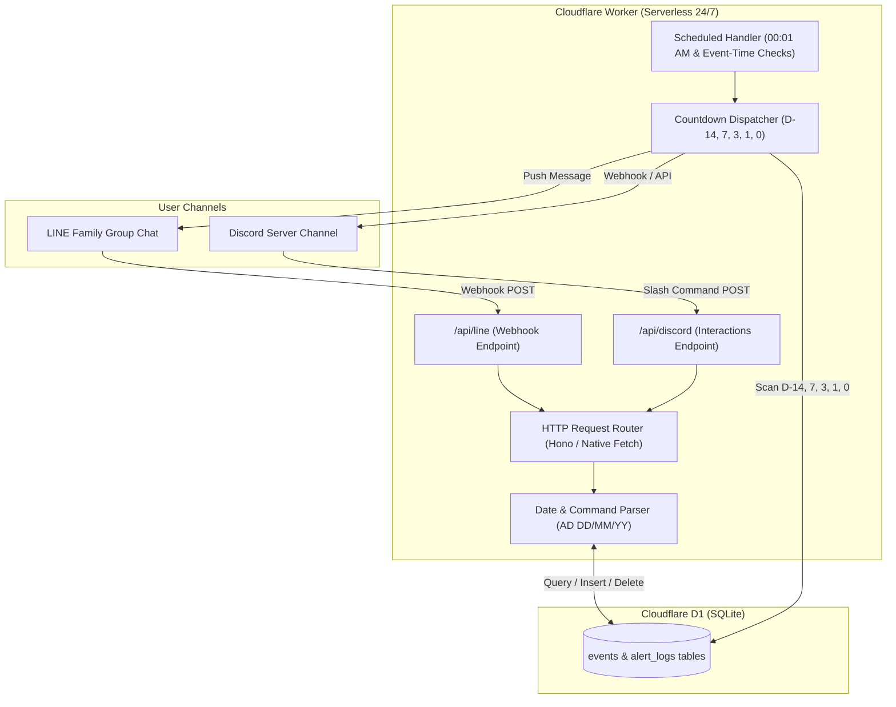

# Work Plan: Cross-Platform Family Event Alert Bot (LINE & Discord)

## Goal Description
Build a lightweight, reliable, and **100% free** cross-platform event reminder system for a family ($\le$ 6 people). Events added from either **LINE** or **Discord** are synchronized in a shared database. A background scheduler automatically checks upcoming dates and delivers countdown alerts at **14, 7, 3, 1, and 0 days (today)** to both platforms.

---

## Architecture Overview



---

## User Review Required

> [!IMPORTANT]
> **Free Tier Quota Strategy for LINE**:
> To strictly stay under LINE's free **200 push messages/month** limit, the bot must be invited to **one shared Family LINE Group Chat** rather than pushing messages to 6 individual DMs. Replies to user commands (`/list`, `/add`) use the Reply API and cost **0 quota**.

> [!WARNING]
> **Serverless Discord Bot Mode**:
> Because the bot runs on Cloudflare Workers (serverless), it uses Discord's **HTTP Interactions endpoint** rather than a long-running WebSocket connection (`client.login()`). This guarantees 0ms cold starts, zero downtime, and zero hosting costs.

---

---

## Confirmed Specifications & Policies

> [!IMPORTANT]
> **1. Daily Alert Timing (00:01 AM Bangkok Time)**:
> * The primary daily alert job runs at **00:01 AM (Asia/Bangkok / UTC+7)** every day.
> * It scans and sends countdown alerts for milestones: **14, 7, 3, 1, and 0 days (today)**.
> 
> **2. "Double Announcement" for Scheduled Event Time**:
> * If an event has a specific start/load time (e.g., `18:00`), on the day of the event (D-0):
>   * **First alert**: Sent at **00:01 AM** (*"🔔 Today's Event: Dinner at 18:00"*).
>   * **Second alert (Double announce)**: Sent at the **exact event time (18:00)** (*"⏰ Happening Now: Dinner"*).
>
> **3. Real-Time Cross-Channel Announcements**:
> * When an event is created/deleted in **LINE**, an instant announcement is posted to **Discord**.
> * When an event is created/deleted in **Discord**, an instant announcement is posted to **LINE**.
> * Quota Impact: Pushing cross-channel updates to the single LINE Family Group easily stays within LINE's 200 free monthly quota for family usage.

---

## Detailed Command Specification

### 1. `/add` (Upload Event)
* **Discord**: `/add title: [Name] date: [DD/MM/YY] time: [HH:mm]`
* **LINE**: `Add: [Name] | [DD/MM/YY] | [HH:mm]` (time is optional)
* **Behavior**: Validates Gregorian (AD) date, inserts into database, and confirms creation.

### 2. `/list` (Show Events)
* **Default (`/list`)**:
  * Shows all upcoming events from **today onwards** sorted chronologically.
  * Displays remaining countdown (e.g., `Today`, `In 3 days`, `In 14 days`).
* **With Date Filter (`/list DD/MM/YY`)**:
  * Shows events matching that specific target date (supporting both 2-digit `26` and 4-digit `2026` years).
  * If no events exist on that date, responds with a clean *"No events scheduled"* message.

### 3. `/delete` (Cancel Event)
* **Discord**: `/delete id: [ID]`
* **LINE**: `Del: [ID]`
* **Behavior**: Deletes the event and automatically halts any pending countdown notifications.

### 4. Background Countdown Alerts (Zero manual input)
* Runs daily at the configured morning time.
* Evaluates `target_date - today`.
* If interval $\in \{14, 7, 3, 1, 0\}$, posts an alert card to both channels and records an entry in `alert_logs` to guarantee no duplicate alerts.

---

## Database Schema (Cloudflare D1 / SQLite)

```sql
-- Events table
CREATE TABLE IF NOT EXISTS events (
    id INTEGER PRIMARY KEY AUTOINCREMENT,
    title TEXT NOT NULL,
    event_date TEXT NOT NULL, -- Format: YYYY-MM-DD
    event_time TEXT,          -- Format: HH:mm (nullable)
    created_by_platform TEXT NOT NULL, -- 'line' or 'discord'
    created_by_user TEXT,
    created_at DATETIME DEFAULT CURRENT_TIMESTAMP
);

-- Alert logs table (Idempotency / Deduplication)
CREATE TABLE IF NOT EXISTS alert_logs (
    id INTEGER PRIMARY KEY AUTOINCREMENT,
    event_id INTEGER NOT NULL,
    alert_type TEXT NOT NULL,        -- 'countdown' (D-14, 7, 3, 1, 0) or 'event_time' (double announce)
    milestone_days INTEGER,          -- 14, 7, 3, 1, or 0 (NULL if alert_type = 'event_time')
    platform TEXT NOT NULL,          -- 'line' or 'discord'
    sent_at DATETIME DEFAULT CURRENT_TIMESTAMP,
    FOREIGN KEY(event_id) REFERENCES events(id) ON DELETE CASCADE,
    UNIQUE(event_id, alert_type, milestone_days, platform)
);

CREATE INDEX IF NOT EXISTS idx_events_date ON events(event_date);
```

---

## Implementation Phases

### Phase 1: Cloudflare Worker & Project Setup
- [ ] Initialize TypeScript Cloudflare Worker project using `wrangler`.
- [ ] Configure `wrangler.toml` with D1 database binding and dual Cron Triggers:
  - `crons = ["1 17 * * *", "*/15 * * * *"]`
  - `1 17 * * *` $\rightarrow$ Fires at 00:01 AM Bangkok time (UTC+7) for countdown alerts.
  - `*/15 * * * *` $\rightarrow$ Checks for upcoming event start times on the event day (Double Announcement).
- [ ] Set up environment secrets management (LINE Channel Secret/Token, Discord Public Key/Bot Token/Webhook).

### Phase 2: Core Utility & Date Engine
- [ ] Implement robust date parsing for `DD/MM/YY` and `DD/MM/YYYY` (AD/Gregorian calendar).
- [ ] Implement Bangkok (`Asia/Bangkok` / UTC+7) timezone calculation utility for determining current day, hour, and D-day intervals.
- [ ] Write unit tests for date parsing and milestone calculation logic.

### Phase 3: Database & Repositories
- [ ] Create D1 migration files for `events` and `alert_logs`.
- [ ] Implement database client methods: `createEvent()`, `listUpcomingEvents()`, `listEventsByDate()`, `deleteEvent()`, and `markAlertSent()`.

### Phase 4: LINE Bot Integration & Cross-Channel Sync
- [ ] Implement signature validation for LINE Webhooks using `@line/bot-sdk`.
- [ ] Build message parser for commands: `Add:`, `/list`, `Del:`.
- [ ] On event creation or deletion via LINE, immediately broadcast cross-channel announcement to Discord.
- [ ] Design clean LINE Flex Messages for listing events and sending alerts.

### Phase 5: Discord Bot Integration & Cross-Channel Sync
- [ ] Implement Discord Ed25519 signature verification for HTTP Interactions.
- [ ] Register Slash Commands: `/add`, `/list [date]`, `/delete [id]`.
- [ ] On event creation or deletion via Discord, immediately broadcast cross-channel announcement to LINE Family Group.
- [ ] Format responses using Discord rich Embeds.

### Phase 6: Scheduler & Double Announcement Dispatcher
- [ ] Implement the `scheduled` event handler in Cloudflare Worker.
- [ ] **00:01 AM Routine**: Scan and dispatch countdown alerts (D-14, D-7, D-3, D-1, D-0) to both LINE and Discord.
- [ ] **Event-Time Routine (Double Announcement)**: If today is the event date and current time matches `event_time`, dispatch the second reminder.
- [ ] Record entries in `alert_logs` to ensure idempotency.

---

## Verification Plan

### Automated Tests
* Unit tests using Vitest:
  ```bash
  npm test
  ```
  * Verify parsing for formats: `13/10/26`, `13/10/2026`, invalid dates, and leap years.
  * Verify countdown interval calculations for D-14, D-7, D-3, D-1, and D-0.
  * Verify database queries using `@cloudflare/vitest-pool-workers` or local SQLite.

### Manual Verification
1. **Local Worker Dev**:
   * Run local worker with `npx wrangler dev`.
   * Simulate LINE Webhook POST with sample commands (`Add: Family Dinner | 20/10/26 | 18:00`, `/list`, `/list 20/10/26`, `Del: 1`).
   * Simulate Discord Interaction POST for `/add`, `/list`, and `/delete`.
2. **Scheduler Verification**:
   * Trigger the scheduled task locally via `npx wrangler trigger "scheduled"`.
   * Verify alert delivery and log deduplication in `alert_logs`.

